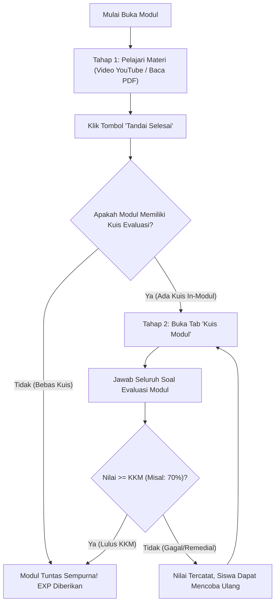

# 👥 Alur Kerja Aplikasi & Peran Aktor (Actors & Workflow)

Dokumen ini menjelaskan alur kerja bisnis secara menyeluruh pada aplikasi **Arrava E-Learning**, termasuk peran masing-masing aktor pengguna, siklus pembelajaran, sistem gamifikasi poin, dan tingkatan rank.

---

## 1. Daftar Aktor & Hak Akses

Sistem membagi pengguna ke dalam beberapa peran melalui tabel [`tipeuser`](file:///e:/Android/laragon/www/elearningarrava/database/migrations/2026_09_20_000002_create_tipeuser_table.php):

| ID Tipe | Nama Peran | Deskripsi & Ruang Lingkup |
| :---: | :--- | :--- |
| **1** | **Admin** | Memiliki akses penuh terhadap manajemen pengguna, penerbitan modul ajar, pembuatan kuis evaluasi, pemantauan analitik pembelajaran, dan pengaturan draf sistem. |
| **2** | **Guru** | Memiliki wewenang membuat materi ajar, merancang butir soal latihan, dan meninjau pencapaian akademik siswa pada kelas terkait. |
| **3** | **Siswa** | Aktor utama peserta didik yang terdaftar pada jenjang tertentu (SD = 1, SMP = 2, SMA = 3). Mengakses modul pembelajaran, mengerjakan kuis, mengumpulkan EXP, dan menaikkan rank. |
| **-** | **Orang Tua / Wali** | Pengguna pendamping yang terhubung ke satu atau beberapa akun siswa melalui tabel relasi `siswa_orangtua` untuk memantau nilai, keaktifan, dan riwayat belajar anak. |

---

## 2. Siklus Pembelajaran Siswa (In-Module Learning Cycle)

Sistem menerapkan model penyelesaian modul dua tahap (*Two-Step Mastery*):

### Langkah 1: Pelajari Materi
* Siswa menyimak video pembelajaran atau membaca literatur PDF/PPT.
* Terdapat ringkasan konsep penting pada tab **Catatan**.
* Siswa menekan tombol **"Tandai Selesai Menonton/Membaca"** untuk mencatatkan progres awal pada tabel `progres_modul_siswa`.

### Langkah 2: Kuis Evaluasi Modul
* Jika modul memiliki butir soal evaluasi, siswa wajib menjawab seluruh pertanyaan kuis in-modul.
* Batas KKM ditentukan oleh pembuat modul (standar: 70%).
* **Poin / EXP hanya akan diberikan satu kali** saat siswa berhasil mencapai kelulusan pertama.

---

## 3. Siklus Pengerjaan Kuis Global (Global Quiz System)

Selain kuis in-modul, siswa dapat menguji kemampuannya pada kuis komprehensif tingkat jenjang:

1. **Pemilihan Kuis**: Siswa memfilter kuis berdasarkan jenjang (SD, SMP, SMA) dan tingkat kesulitan (Mudah, Sedang, Sulit).
2. **Akses Bertoken (Opsional)**: Untuk ujian resmi atau ulangan semester, kuis dapat dikunci menggunakan token (misal: `SDJUARA`, `SMPHEBAT`, `SMASUKSES`).
3. **Pilihan Mode Pengerjaan**:
   * **Mode Biasa**: Menggunakan batas durasi total ujian (misal: 25–40 menit). Siswa dapat berpindah nomor secara fleksibel. Pengiriman jawaban diblokir bila masih ada nomor yang kosong.
   * **Mode Wayground**: Bergaya *Kahoot fast-paced*. Menghitung mundur batas waktu per nomor soal (misal: 15–25 detik). Soal berganti otomatis ketika waktu habis.
4. **Penilaian Atomik**: Backend menghitung perolehan skor, mencatat riwayat ke `hasilquizmodul`, dan menambahkan poin ke akun siswa jika siswa lulus tanpa duplikasi poin ganda.

---

## 4. Sistem Gamifikasi (Poin & Tingkatan Rank)

Setiap poin yang berhasil diraih siswa secara otomatis diakumulasikan ke kolom `total_poin` pada tabel `user`. Rank siswa dihitung dinamis menggunakan metode [`getRankTierAttribute()`](file:///e:/Android/laragon/www/elearningarrava/app/Models/User.php):

| Poin Min | Poin Max | Nama Rank | Warna Tema UI |
| :---: | :---: | :--- | :--- |
| 0 | 99 | **Pemula** | Slate (Abu-abu) |
| 100 | 299 | **Perunggu** | Amber (Cokelat Perunggu) |
| 300 | 599 | **Perak** | Zinc (Perak Berkilau) |
| 600 | 999 | **Emas** | Yellow (Emas Terang) |
| 1.000 | 1.499 | **Platinum** | Cyan (Biru Kehijauan) |
| 1.500 | 2.199 | **Berlian** | Blue (Biru Safir) |
| 2.200 | 2.999 | **Master** | Purple (Ungu Gelap) |
| 3.000+ | ~ | **Legenda** | Rose / Crimson (Merah Api) |

---

## 5. Alur Kerja Orang Tua (Parental Monitoring)
1. Orang tua masuk menggunakan email / nomor kontak terdaftar.
2. Memilih anak yang berada di bawah bimbingannya.
3. Memantau progres belajar modul yang sudah selesai dipelajari, status kelulusan kuis, nilai rata-rata, dan perolehan poin rank anak terkini.
