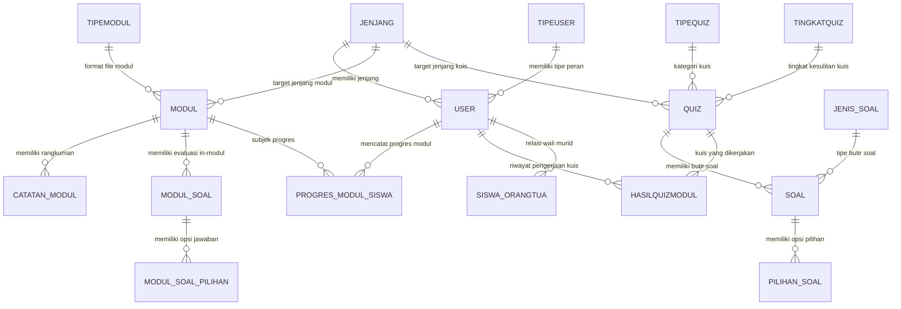

# 🗄️ Skema Basis Data & Relasi Entitas (Database Schema & ERD)

Dokumen ini mendokumentasikan skema database MySQL pada aplikasi **Arrava E-Learning**, mencakup seluruh tabel master, entitas transaksi pembelajaran, relasi antar-tabel (*foreign keys*), dan diagram ERD.

---

## 1. Diagram Relasi Entitas (ERD)

---

## 2. Struktur Tabel Utama

### A. Entitas Pengguna & Hak Akses
* **`user`**:
  * `id_user` (PK, int unsigned auto-increment)
  * `nama` (varchar 255)
  * `email` (varchar 255, unique)
  * `nisn` (varchar 20, nullable/unique untuk siswa)
  * `password` (varchar 255 hash)
  * `id_tipeuser` (FK -> `tipeuser.id_tipeUser`)
  * `id_jenjang` (FK -> `jenjang.id_jenjang`, nullable)
  * `total_poin` (int, default: 0)
  * `kelas` (varchar 50, nullable)
  * `foto_profil` (varchar 255, nullable)
* **`jenjang`**: `id_jenjang` (1 = SD, 2 = SMP, 3 = SMA), `nama_tipe`.
* **`tipeuser`**: `id_tipeUser` (1 = admin, 2 = guru, 3 = siswa), `nama_tipe`.

---

### B. Entitas Modul Pembelajaran
* **`modul`**:
  * `id_modul` (PK, int unsigned)
  * `judul_modul` (varchar 255)
  * `id_jenjang` (FK -> `jenjang.id_jenjang`)
  * `id_tipemodul` (FK -> `tipemodul.id_tipemodul`)
  * `file_materi` (text - URL YouTube atau path penyimpanan berkas PDF/PPT)
  * `tipe_file` (enum: `'link'`, `'upload'`)
  * `foto_modul` (varchar 255, path cover)
  * `progressModul` (varchar 50, `'Tersedia'` / `'Draft'`)
  * `kkm_quiz` (int, batas kelulusan kuis in-modul, default: 70)
  * `poin_modul` (int, reward EXP saat modul tuntas, default: 50)
* **`catatan_modul`**:
  * `id_catatan` (PK), `id_modul` (FK), `judul`, `isi` (text), `urutan`.
* **`modul_soal`** & **`modul_soal_pilihan`**:
  * Butir soal evaluasi khusus yang melekat langsung di dalam modul.
  * Relasi: `modul` -> `modul_soal` -> `modul_soal_pilihan` (`is_benar` boolean).
* **`progres_modul_siswa`**:
  * `id_progres` (PK), `id_user` (FK), `id_modul` (FK)
  * `materi_selesai` (boolean), `quiz_selesai` (boolean), `nilai_quiz` (int 0–100), `quiz_lulus` (boolean), `poin_didapat` (int).

---

### C. Entitas Kuis & Bank Soal Global
* **`quiz`**:
  * `id_quiz` (PK, int unsigned)
  * `kode_quiz` (varchar unique, format: `QZ-YYYYMMDD-XXXXXX`)
  * `judul` (varchar 255), `deskripsi` (text nullable)
  * `id_tipequiz` (FK -> `tipequiz`, 1 = Harian, 2 = Ulangan)
  * `id_tingkatquiz` (FK -> `tingkatquiz`, 1 = Mudah, 2 = Sedang, 3 = Sulit)
  * `id_jenjang` (FK -> `jenjang.id_jenjang`)
  * `mode_pengerjaan` (varchar, default: `'wayground'`, opsi: `'biasa'`)
  * `durasi_total_menit` (int unsigned, nullable, digunakan jika mode biasa)
  * `token` (varchar 50, nullable, jika butuh kata sandi masuk kuis)
  * `opsi_preview` (varchar 20, default: `'lengkap'`)
  * `proggressQuiz` (varchar 50, `'Tersedia'` / `'Draft'`)
  * `waktu_kadaluarsa` (datetime, nullable)
* **`soal`**:
  * `id_soal` (PK, int unsigned)
  * `kode_soal` (varchar unique, format: `SL-QZ...-01`)
  * `id_quiz` (FK -> `quiz.id_quiz`, on delete cascade)
  * `id_jenis_soal` (FK -> `jenis_soal`, 1 = Pilihan Ganda, 2 = Isian Singkat, 3 = Benar/Salah)
  * `pertanyaan` (text)
  * `jawaban_benar` (text, kunci jawaban: label 'A'/'B' atau teks isian singkat lowercase)
  * `foto_soal` (varchar 255, nullable)
  * `poin` (int, bobot skor soal)
  * `durasi_detik` (int, batas waktu per-soal pada mode wayground)
* **`pilihan_soal`**:
  * `id_pilihan` (PK), `id_soal` (FK), `label` ('A', 'B', 'C', 'D'), `teks_pilihan`, `is_correct` (boolean).
* **`hasilquizmodul`**:
  * `id_hasil` (PK), `id_user` (FK), `id_quiz` (FK), `total_poin`, `poin_didapat`, `is_lulus` (boolean), `waktu_dapat` (timestamp).

---

## 3. Aturan Integritas Data & Transaksi
1. **Cascade Delete**: Menghapus baris `quiz` akan otomatis menghapus seluruh anak baris di `soal` dan `pilihan_soal`.
2. **Pemberian Poin Atomik**: Eksekusi penambahan poin siswa dilakukan dalam blok `DB::transaction` dengan `lockForUpdate()` pada record user untuk mencegah *race conditions*.
3. **Filter Jenjang Eksklusif**: Siswa pada jenjang SD tidak dapat mengakses modul atau kuis bertingkat SMP/SMA di tingkat query database controller.

