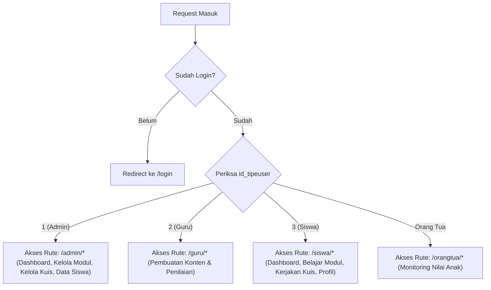

# 🔐 Autentikasi, Hak Akses & Pembagian Peran (Auth & RBAC)

Dokumen ini menjelaskan arsitektur autentikasi, manajemen session, pembagian peran pengguna (*Role-Based Access Control*), dan isolasi data per jenjang pada backend **Arrava E-Learning**.

---

## 1. Mekanisme Autentikasi

Login web menggunakan `LoginController`. Login Flutter menggunakan `Api\AuthController`. Keduanya menggunakan email dan kata sandi. OTP digunakan saat pendaftaran siswa.

* **Login web**. Laravel membuat sesi dan membuka dashboard sesuai peran. Opsi **Ingat saya di perangkat ini** memungkinkan pemulihan sesi melalui cookie selama 30 hari.
* **Login Flutter**. `POST /api/login` menerima `email` dan `password`. Respons sukses mengembalikan `token` dan `user`. Simpan token di penyimpanan aman perangkat dan gunakan sebagai bearer token saat memanggil `GET /api/me`. Token baru berlaku 30 hari. `POST /api/logout` mencabut token perangkat saat ini.
* **Konfigurasi**. Jalankan `php artisan migrate` untuk menambahkan `remember_token`. Gunakan `MAIL_MAILER=smtp` dengan host, port, kredensial, dan alamat pengirim yang sesuai di produksi. Sediakan cache bersama dengan dukungan lock apabila aplikasi berjalan pada beberapa server. Konfigurasi lokal `MAIL_MAILER=log` menulis email OTP ke log Laravel untuk pengujian.
* **Keamanan Kata Sandi**: Menggunakan algoritma hash standar industri `bcrypt` (`password_hash`).
* **Pendaftaran Siswa Baru**:
  * Siswa mendaftar dengan menginput nama, email, NISN, kata sandi, dan memilih **Jenjang Sekolah** (SD, SMP, atau SMA).
  * Halaman verifikasi menampilkan email siswa sebagai tujuan pengiriman. Kode berlaku selama 5 menit, sekali pakai, dan dibatalkan setelah lima percobaan salah. Tombol kirim ulang aktif setelah 60 detik. Kode baru menggantikan kode lama.
  * Setelah email siswa terverifikasi, sistem membuat akun siswa dan memproses data akun orang tua jika diisi. Email orang tua tidak menerima OTP. Sesi pendaftaran berlaku 30 menit.
  * Data otomatis diberi `id_tipeuser = 3` (siswa) dan `total_poin = 0`.
* **Pencegahan Akses Tak Sah**:
  * Pengguna yang belum terautentikasi otomatis dialihkan ke rute `/login`.
  * Middleware [`CheckRole`](file:///e:/Android/laragon/www/elearningarrava/app/Http/Middleware/CheckRole.php) memvalidasi peran pengguna pada setiap rute berproteksi.

---

## 2. Struktur Pembagian Peran & Prefix Rute



### Tabel Rincian Hak Akses Rute:
| Aktor | Prefix Rute | Izin Utama | Larangan Akses |
| :--- | :---: | :--- | :--- |
| **Admin** | `/admin` | Mengubah seluruh kuis/modul, publish/draft materi, manajemen data siswa, melihat preview kuis tanpa skor. | Tidak dapat mengerjakan kuis sebagai peserta berpoin. |
| **Guru** | `/guru` | Membuat draft modul dan butir pertanyaan latihan. | Tidak dapat menghapus master data sistem. |
| **Siswa** | `/siswa` | Mempelajari modul jenjangnya, mengerjakan kuis, klaim reward EXP, mengubah foto profil. | Tidak dapat mengakses panel administrasi `/admin/*`. |
| **Orang Tua** | `/orangtua` | Memilih anak asuh terhubung, memantau riwayat kuis dan skor anak. | Tidak dapat mengisi jawaban kuis atas nama anak. |

---

## 3. Isolasi Jenjang Pendidikan (Jenjang-Scoped Isolation)

Untuk mencegah siswa SD melihat atau mengerjakan kuis SMA (atau sebaliknya), backend menerapkan isolasi berlapis:

1. **Lapisan Query Listing**:
   ```php
   // SiswaController.php
   $user = Auth::user();
   $query = Quiz::published()->belumKadaluarsa();

   if ($user && $user->id_jenjang) {
       $query->where('id_jenjang', $user->id_jenjang);
   }
   ```
2. **Lapisan Validasi Eksekusi**:
   Saat siswa mencoba memulai kuis via URL langsung (`/siswa/quiz/{id}`), method `tolakJikaBukanJenjangnya()` memverifikasi apakah kuis tersebut sesuai dengan `id_jenjang` siswa. Jika tidak cocok, request langsung dialihkan kembali dengan pesan error larangan akses.

