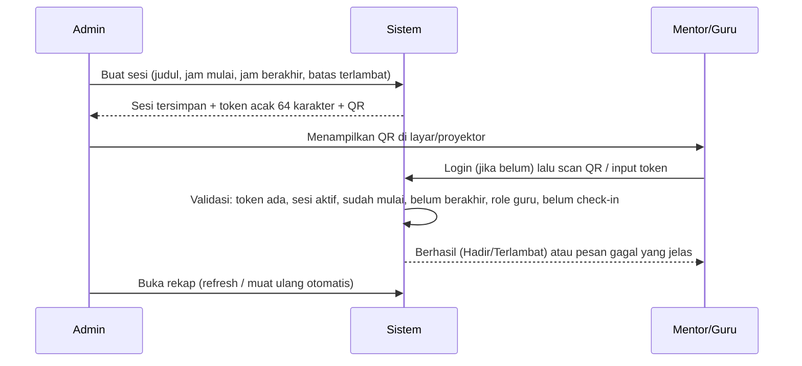

# 🧑‍🏫 Absensi Mentor/Guru dengan QR Code (dibuat Admin)

Fitur ini mencatat kehadiran **mentor/guru** (bukan siswa). Admin membuat *sesi absensi*, sistem menampilkan QR untuk sesi tersebut, lalu mentor/guru yang sudah login memindai QR (atau memasukkan token manual) untuk check-in. Admin melihat rekap kehadiran per sesi.

> Berbeda dengan **Presensi siswa** (`/guru/presensi`, tabel `sesi_presensi`/`presensi`), di mana guru memindai QR milik siswa. Pada fitur ini arahnya terbalik: **admin** menampilkan QR sesi dan **guru** memindainya. Kedua fitur terpisah dan tidak saling mengubah data.

---

## 1. Alur Utama



Isi QR adalah **tautan** `…/attendance/check-in?token=TOKEN`. Membuka tautan itu (misalnya dari aplikasi kamera ponsel) menampilkan halaman **konfirmasi**; kehadiran baru dicatat saat tombol *Check-in sekarang* ditekan (`POST`, dilindungi CSRF). Halaman `GET` sengaja **tidak** mengubah data agar aman dari prefetch/bot.

Pengguna yang belum login dialihkan ke `/login`, lalu kembali ke halaman check-in setelah masuk (`url.intended`; jalur login AJAX di `LoginController` juga menghormati tujuan ini khusus untuk path `/attendance/*`).

---

## 2. Struktur Tabel Baru

> Konvensi penamaan: tabel/kolom fitur ini memakai nama Inggris sesuai spesifikasi permintaan. Tabel pengguna proyek bernama `user` dengan PK `id_user`, sehingga foreign key memakai `unsignedInteger` yang merujuk `user.id_user`.

### `attendance_sessions`
| Kolom | Tipe | Keterangan |
| :--- | :--- | :--- |
| `id` | bigint PK | |
| `title` | string | Judul sesi |
| `token` | string(64), **unique** | `Str::random(64)`; hanya ditampilkan ke admin |
| `created_by` | unsigned int → `user.id_user` | Admin pembuat |
| `starts_at` | datetime | Jam mulai |
| `expires_at` | datetime | Jam berakhir |
| `late_after_minutes` | smallint, nullable | Menit setelah `starts_at`; lewat dari ini = terlambat. Null = tidak ada batas |
| `status` | enum `active`/`closed`/`expired` | default `active` |
| `created_at`, `updated_at` | timestamps | |

Indeks: `unique(token)`, `index(status, expires_at)`.

### `attendance_records`
| Kolom | Tipe | Keterangan |
| :--- | :--- | :--- |
| `id` | bigint PK | |
| `attendance_session_id` | FK → `attendance_sessions.id` (cascade) | |
| `user_id` | unsigned int → `user.id_user` (cascade) | Selalu dari sesi login |
| `checked_in_at` | datetime | Waktu server |
| `status` | enum `hadir`/`terlambat` | |
| `ip_address` | string(45), nullable | |
| `user_agent` | text, nullable | |
| `created_at`, `updated_at` | timestamps | |

Constraint: **`unique(attendance_session_id, user_id)`** — satu mentor satu kali check-in per sesi.

### Model
* `App\Models\AttendanceSession` — `creator()`, `records()`, scope `active()` / `expired()`, `effectiveStatus()`, `lateThreshold()`, `checkInUrl()`. `token` ada di `$hidden`.
* `App\Models\AttendanceRecord` — `session()`, `user()`.

---

## 3. Route

Didefinisikan di `routes/attendance.php`, dimuat dari akhir `routes/web.php`.

| Method | URL | Nama route | Middleware | Fungsi |
| :--- | :--- | :--- | :--- | :--- |
| GET | `/admin/attendance` | `admin.attendance.index` | auth, role:admin | Daftar sesi |
| GET | `/admin/attendance/create` | `admin.attendance.create` | auth, role:admin | Form buat sesi |
| POST | `/admin/attendance` | `admin.attendance.store` | auth, role:admin | Simpan sesi |
| GET | `/admin/attendance/{attendanceSession}/qr` | `admin.attendance.qr` | auth, role:admin | QR besar + token |
| GET | `/admin/attendance/{attendanceSession}/report` | `admin.attendance.report` | auth, role:admin | Rekap |
| GET | `/admin/attendance/{attendanceSession}/export` | `admin.attendance.export` | auth, role:admin | Unduh CSV |
| PATCH | `/admin/attendance/{attendanceSession}/close` | `admin.attendance.close` | auth, role:admin | Tutup sesi |
| GET | `/attendance/scan` | `attendance.scan` | auth, role:guru | Halaman scan + input manual |
| GET | `/attendance/check-in?token=` | `attendance.check-in.link` | auth, role:guru, throttle:30,1 | Konfirmasi dari tautan QR |
| POST | `/attendance/check-in` | `attendance.check-in` | auth, role:guru, throttle:20,1 | Proses check-in |

---

## 4. Komponen Backend

| Lapisan | File |
| :--- | :--- |
| Service | `app/Services/AttendanceService.php` — buat sesi + token, validasi & check-in, status hadir/terlambat, tutup sesi, tandai expired, QR SVG, rekap, CSV |
| Controller admin | `app/Http/Controllers/Admin/AttendanceSessionController.php` |
| Controller mentor | `app/Http/Controllers/AttendanceCheckInController.php` |
| Form Request | `app/Http/Requests/StoreAttendanceSessionRequest.php`, `CheckInAttendanceRequest.php` |
| Policy | `app/Policies/AttendanceSessionPolicy.php` (ditemukan otomatis oleh Laravel) |
| Exception | `app/Exceptions/AttendanceCheckInException.php` (kode alasan + status HTTP) |
| JS scanner | `resources/js/attendance-scan.js` (memakai `qr-scanner` yang sudah ada) |

### Aturan validasi check-in (selalu di server)
1. Role harus **guru** (`id_tipeuser = 2`). Admin, siswa, dan orang tua ditolak (403).
2. Format token 64 karakter alfanumerik dan token ditemukan.
3. Status bukan `closed`; belum lewat `expires_at` (jika lewat, status ditandai `expired`).
4. Sudah melewati `starts_at`.
5. Belum pernah check-in pada sesi itu (cek service **dan** unique constraint).
6. Status: `terlambat` bila `late_after_minutes` diisi dan waktu server melewati `starts_at + late_after_minutes`; selain itu `hadir`.

| Alasan (`reason`) | HTTP |
| :--- | :---: |
| `token_invalid`, `session_closed`, `session_expired`, `not_started` | 422 |
| `already_checked_in` | 409 |
| `forbidden_role` | 403 |
| `too_many_attempts` | 429 |

---

## 5. Keamanan
* Token acak 64 karakter (`Str::random`), unik, tidak berurutan, tanpa data sensitif; tidak ikut serialisasi model (`$hidden`).
* Halaman yang menampilkan token (`/admin/attendance/{id}/qr`) hanya untuk admin dan dikirim dengan `Cache-Control: no-store`.
* Identitas pelaku **selalu** `auth()->user()`; field `user_id` dari request diabaikan.
* Rate limiting berlapis: `throttle` pada route, ditambah batas **10 token salah per menit** per pengguna dan per IP di `AttendanceService`.
* CSRF aktif pada form dan permintaan `fetch` (header `X-CSRF-TOKEN`).
* CSV dinetralkan dari *formula injection* (sel berawalan `= + - @`).

---

## 6. Cara Pakai

**Persiapan**
```bash
php artisan migrate
npm run build        # agar scanner kamera aktif
```
Kamera di browser hanya berfungsi pada **HTTPS** atau `localhost`. Jika tidak tersedia, gunakan input token manual.

**Admin**
1. Menu **Absensi Mentor** → **Buat Sesi Baru** → isi judul, jam mulai, jam berakhir, batas terlambat (opsional).
2. Setelah disimpan, QR tampil. Gunakan **Layar penuh** untuk proyektor. Token dan tautan tersedia untuk input manual.
3. **Rekap** menampilkan yang sudah/belum check-in dan bisa diunduh sebagai CSV. **Tutup** mengakhiri sesi lebih awal.

**Mentor/Guru**
1. Login → menu **Absen Mentor** → **Mulai Scan** dan arahkan ke QR (atau tempel token lalu **Check-in**).
2. Atau pindai QR dengan kamera ponsel, buka tautannya, login bila diminta, lalu tekan **Check-in sekarang**.

---

## 7. Pengujian
```bash
php artisan test --filter=AttendanceMentorTest
```
