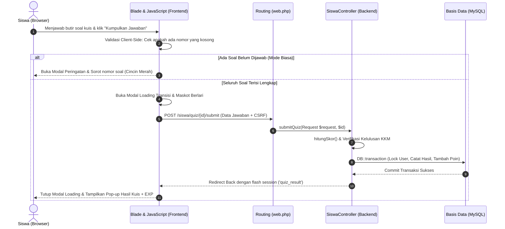

# 🔄 Integrasi Frontend & Backend (Data Communication Flow)

Dokumen ini menjelaskan jembatan komunikasi dan siklus pertukaran data antara tampilan **Frontend (Blade & JavaScript)** dan server **Backend (Laravel Controller)** pada aplikasi **Arrava E-Learning**.

---

## 1. Diagram Siklus Permintaan & Tanggapan (Request-Response Lifecycle)



---

## 2. Pola Pertukaran Data Utama

### A. Pengiriman Form Dinamis (Dynamic Hidden Inputs)
Pada halaman pembuat kuis admin ([`admin/quiz/create.blade.php`](file:///e:/Android/laragon/www/elearningarrava/resources/views/admin/quiz/create.blade.php)):
* Seluruh butir soal disimpan sementara dalam array memori JavaScript `soalList`.
* Saat tombol submit ditekan, fungsi JavaScript menghasilkan elemen input tersembunyi (*hidden inputs*) secara otomatis:
  ```html
  <input type="hidden" name="soal[0][pertanyaan]" value="...">
  <input type="hidden" name="soal[0][jenis_soal]" value="kuis">
  <input type="hidden" name="soal[0][pilihan][0][teks_pilihan]" value="Jakarta">
  <input type="hidden" name="soal[0][pilihan][0][is_correct]" value="1">
  ```
* Controller backend menerima data ini sebagai array terstruktur `$request->input('soal')` dan menormalkannya melalui method `normalizeQuestionAnswers()`.

### B. Validasi Dua Lapis (Two-Tier Validation)

| Aspek | Validasi Sisi Klien (Frontend JS) | Validasi Sisi Server (Backend Controller) |
| :--- | :--- | :--- |
| **Soal Kosong di Kuis Biasa** | Memeriksa radio button dan input teks. Jika ada nomor kosong, memunculkan modal [`#quizUnansweredModal`](file:///e:/Android/laragon/www/elearningarrava/resources/views/siswa/mengerjakan-quiz.blade.php) dan melompatkan kursor ke soal pertama yang kosong. | Memeriksa array `jawabanSiswa`. Jika ada nomor yang kosong dan bukan karena timeout (`is_timeout = 0`), backend mengembalikan redirect error: *"Jawaban belum lengkap! Soal nomor X belum dijawab."* |
| **Penyusunan Kuis Admin** | Menghitung jumlah pilihan terisi (min. 2) dan memeriksa keberadaan tepat 1 kunci jawaban. Memunculkan alert menyebutkan nomor soal: *"⚠️ Kesalahan pada Soal #X"*. | Menolak request dengan `ValidationException::withMessages(['soal.X.pilihan' => 'Soal #X: ...'])` jika data yang dikirim tidak valid. |

### C. Sinkronisasi Sesi Waktu (Timer & Session State)
* **Mode Biasa**: Waktu mulai disimpan di session server `quiz_attempt.{userId}.{quizId}`. Frontend menjalankan hitung mundur waktu lokal. Jika waktu habis di peramban, script menyetel `is_timeout = 1` dan memicu auto-submit. Server memverifikasi waktu dengan toleransi latensi jaringan (*grace period* 3 detik).
* **Mode Wayground**: Server mencatat waktu mulai per nomor soal `question_started_at`. Siswa yang terlambat menjawab melebihi durasi soal + grace period dianggap tidak menjawab (jawaban diset `null`).

### D. Sinkronisasi Web Audio & Siklus Gambar Statis/Animasi
Pada widget pixel salju di [`sidebar.blade.php`](file:///e:/Android/laragon/www/elearningarrava/resources/views/components/sidebar.blade.php):
* State JavaScript mengontrol elemen `` dan objek `new Audio()` secara sinkron.
* Event `audio.onended` atau pewaktu timeout durasi audio memicu pengembalian atribut `src` dari `sideSnow.gif` kembali ke gambar diam `sideSnow.webp`, memastikan memori peramban tetap ringan tanpa loop tanpa akhir.
